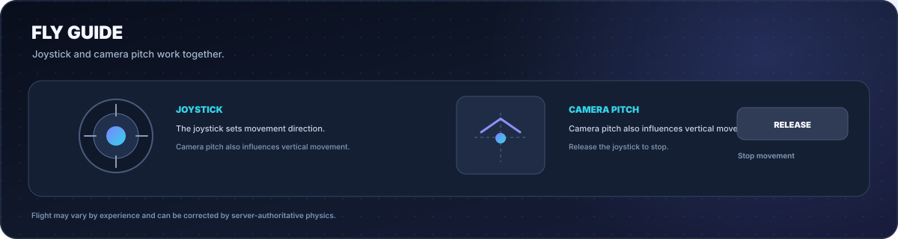

# Livia Panel

  
  
  
  

<a href="README.md">Bahasa Indonesia</a> · <a href="README.en.md">English</a>

<strong>One panel. Five controls. Designed for touch.</strong> 
Speed, Jump, Fly, No Clip, and Flashlight in one compact Lua script with a draggable, minimizable interface.

  <a href="#quick-start">Quick start</a> ·
  <a href="#features">Features</a> ·
  <a href="#usage-guide">Usage guide</a> ·
  <a href="#limitations-and-safety">Safety</a> ·
  <a href="#development">Development</a> ·
  <a href="#sources-attribution-and-license">Sources &amp; license</a> ·
  <a href="#contributing">Contributing</a> ·
  <a href="#project-security">Security</a>

---

## About

**Livia Panel** is a single-file Lua script for Roblox environments that support and explicitly permit client-side script execution. It groups movement and lighting controls in a dark interface with indigo-cyan accents, large touch targets, and simple panel controls.

No external UI library is required. The main file is [`LiviaPanel.lua`](LiviaPanel.lua).

> **Note:** README graphics are interface illustrations for documentation, not direct screenshots captured from Roblox. Script behavior still depends on the game and execution environment.

## Quick start

1. Open [`LiviaPanel.lua`](LiviaPanel.lua).
2. Copy the script and run it only in an experience you own or an environment that explicitly permits client-side Lua scripts.
3. Tap **OFF** to enable a feature. For Speed, Jump, and Fly, adjust the numeric value.
4. Drag the panel from its header. Use the minus button to minimize it or **X** to close and clean up the features.

Optional: load from the raw URL only in an environment that explicitly permits `loadstring` and `HttpGet`. Review the script before running it; do not use an executor to bypass Roblox experience rules or security:

~~~lua
loadstring(game:HttpGet("https://raw.githubusercontent.com/akndrn000/LiviaPanel.lua/main/LiviaPanel.lua"))()
~~~

## Features

| Feature | Default | Purpose |
| --- | ---: | --- |
| **Speed** | 50 | Sets `Humanoid.WalkSpeed` while enabled. |
| **Jump** | 100 | Sets `Humanoid.JumpPower` while enabled. |
| **Fly** | 60 | Air movement guided by joystick input and camera orientation. |
| **No Clip** | OFF | Changes `CanCollide` on local character parts and records original values for cleanup. |
| **Flashlight** | OFF | Adds a local `SpotLight` to the head or `HumanoidRootPart`, when available. |
| **Panel** | — | Draggable UI with minimize-to-**L** and close controls. |

## Usage guide

### Panel controls

| Action | Result |
| --- | --- |
| Tap a toggle | Changes the ON/OFF state. |
| Drag more than 10 px | Moves the panel without accidentally activating a button. |
| Minus button | Hides the main panel and shows the **L** button to reopen it. |
| X button | Runs cleanup, stops managed features, disconnects event connections, and removes the UI. |

### Using Fly

The joystick sets movement direction. While moving forward, camera pitch also influences upward/downward movement. Release the joystick to stop moving.

## Defaults and reset behavior

| Feature | When OFF |
| --- | --- |
| Speed | `WalkSpeed` is reset to 16. |
| Jump | `JumpPower` is reset to 50. |
| Fly | Script-created flight forces are removed. |
| No Clip | Recorded `CanCollide` values are restored for character parts that still exist. |
| Flashlight | The script-created `SpotLight` is removed. |

> Speed and Jump use fixed reset values of 16 and 50. Experiences with custom movement systems may have different defaults. Server-authoritative physics can also correct movement changes.

## Limitations and safety

- **Client-side behavior:** local changes are not always replicated to the server. Games may ignore or correct movement changes.
- **No Clip:** only changes the `CanCollide` property of character parts processed by the script. It does not guarantee bypassing server-controlled collision systems.
- **Flashlight:** the light is created locally; appearance and range depend on the experience's lighting.
- **Compatibility:** Roblox or individual experiences may change, which can cause the script to stop working as expected.
- **Roblox rules:** use this to develop or test your own experiences or an environment that explicitly authorizes this use. Do not use movement/collision features for an unfair advantage in other creators' experiences. Roblox states that cheating/exploiting violates its Terms of Use and can lead to account deletion ([official guidance](https://en.help.roblox.com/hc/en-us/articles/203312450-Cheating-and-Exploiting)).
- The script does not require passwords, cookies, or account credentials.

## Development

The main script is intentionally kept as a single file. README artwork is SVG and can be regenerated without external Python packages.

~~~bash
python3 docs/generate-images.py
~~~

This creates Indonesian and English illustrations in `docs/screenshots/` and the logo at `docs/brand.svg`.

#### Documentation checks

Run `python3 scripts/check_docs.py` to validate local links, XML syntax, non-empty illustrations, and exact consistency between the Fly illustrations shown in the READMEs and their source generator. This check runs automatically through GitHub Actions; it is not a Roblox runtime test.

### Repository structure

~~~text
LiviaPanel.lua
README.md
README.en.md
LICENSE
CONTRIBUTING.md
SECURITY.md
scripts/
└── check_docs.py
docs/
├── generate-images.py
├── SOURCES.md
├── brand.svg
└── screenshots/
    ├── banner.id.svg / banner.en.svg
    ├── preview.id.svg / preview.en.svg
    ├── features.id.svg / features.en.svg
    ├── workflow.id.svg / workflow.en.svg
    ├── controls.id.svg / controls.en.svg
    ├── fly.id.svg / fly.en.svg / fly-guide.id.svg / fly-guide.en.svg
    ├── safety.id.svg / safety.en.svg
    └── social-preview.svg
~~~

## Sources, attribution, and license

### Reference sources

- [Roblox Creator Hub — Scripting](https://create.roblox.com/docs/scripting), [Luau](https://create.roblox.com/docs/luau), and the [Roblox Engine API reference](https://create.roblox.com/docs/reference/engine) are technical references for language concepts and APIs. This does not mean the project is official Roblox code.
- [Roblox Support — Cheating and Exploiting](https://en.help.roblox.com/hc/en-us/articles/203312450-Cheating-and-Exploiting) provides the relevant responsible-use policy.
- See [`docs/SOURCES.md`](docs/SOURCES.md) for the source list, attribution scope, and licensing notes.

### Artwork attribution

The logo and SVG illustrations in `docs/` are project documentation artwork generated by [`docs/generate-images.py`](docs/generate-images.py) using Python's standard library. They are mockups/diagrams, not screenshots captured from a live Roblox session. The project does not bundle an external UI library.

Roblox, Roblox Studio, and other third-party marks remain the property of their respective owners. Livia Panel is an independent project and is not affiliated with, sponsored by, or endorsed by Roblox Corporation.

### MIT license

This repository uses the [MIT License](LICENSE), with the 2026 copyright notice shown in the `LICENSE` file. The license permits use, modification, and redistribution of the covered project material, provided the copyright and permission notice are retained. It does not grant rights to Roblox trademarks or services. Read the full `LICENSE` text for its terms.

## Contributing

Contributions are welcome through Issues or Pull Requests. See [`CONTRIBUTING.md`](CONTRIBUTING.md) for the expected checks and [`SECURITY.md`](SECURITY.md) for security reporting. Do not include personal information, tokens, or account credentials.

## Project security

Use this only in experiences you own or in environments that explicitly authorize it. Do not use Speed, Jump, Fly, or No Clip to gain an unfair advantage in other creators' experiences. Roblox states that cheating/exploiting violates its Terms of Use and can lead to account deletion. See [Roblox's official guidance](https://en.help.roblox.com/hc/en-us/articles/203312450-Cheating-and-Exploiting).

---

  Livia Panel · Single-file Lua, compact controls, and a touch-first interface.

