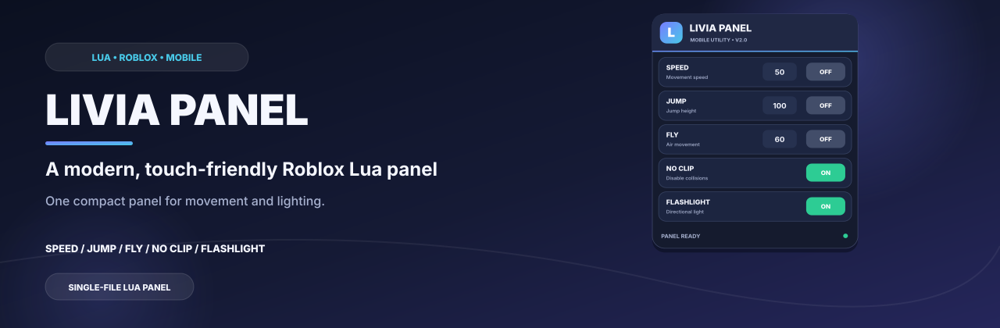
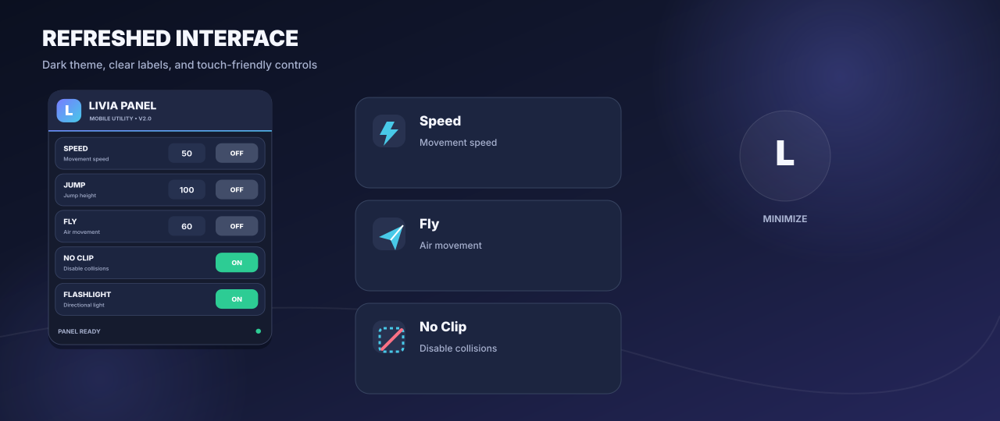
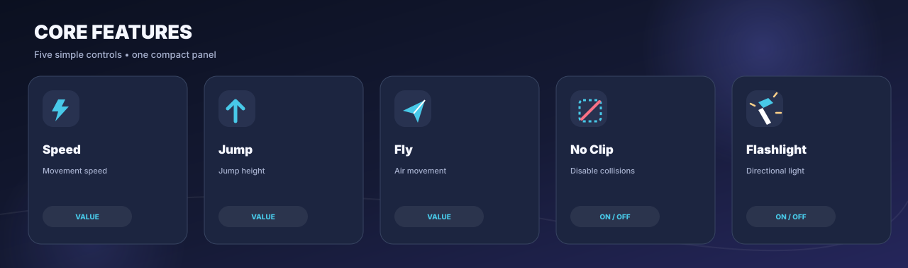
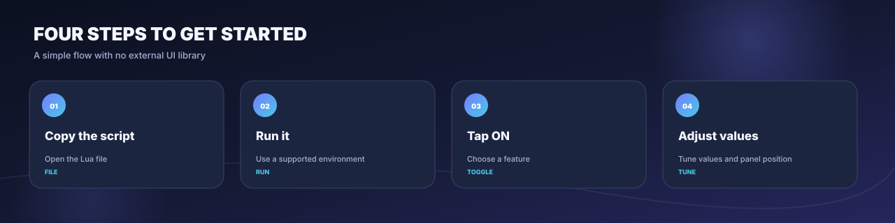
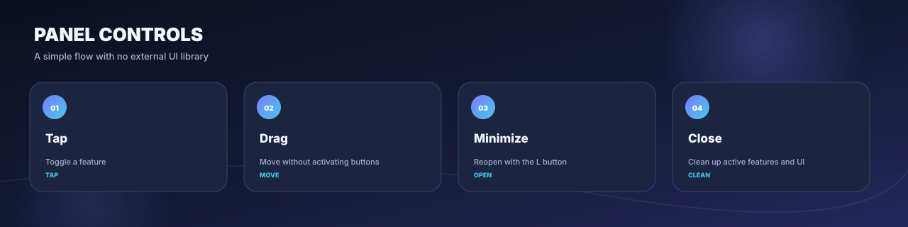
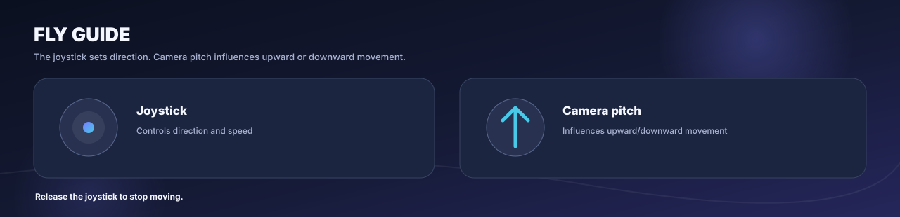
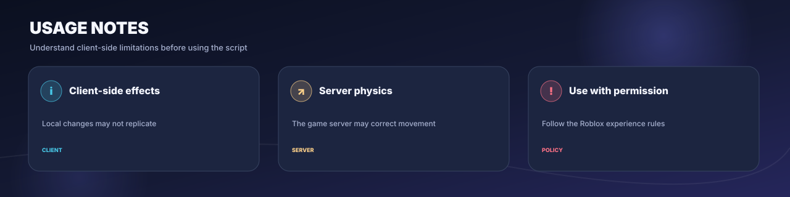

   

<a href="README.md">Bahasa Indonesia</a> · <a href="README.en.md">English</a>

<strong>A modern, compact, touch-friendly Lua panel.</strong> Speed, Jump, Fly, No Clip, and Flashlight sit in one draggable, minimizable UI.

<a href="#features">Features</a> · <a href="#preview">Preview</a> · <a href="#how-to-use">How to use</a> · <a href="#limitations-and-safety">Limitations</a>

---

## Overview

Livia Panel is a single-file script for Roblox environments that support client-side Lua execution. The refreshed interface uses a dark theme, gradient accents, supporting labels, and larger touch targets for small screens. No external UI library is required.

## Preview

## Features

| Feature | Control | Description |
| --- | --- | --- |
| **Speed** | Value + ON/OFF | Sets WalkSpeed while enabled. Default value: 50. |
| **Jump** | Value + ON/OFF | Sets JumpPower while enabled. Default value: 100. |
| **Fly** | Value + ON/OFF | Air movement guided by the camera and joystick. Default value: 60. |
| **No Clip** | ON/OFF | Disables CanCollide on character parts while enabled, then restores recorded values when disabled. |
| **Flashlight** | ON/OFF | Adds a warm SpotLight to the character's head when that part is available. |
| **Panel** | Drag / Minimize / Close | Move the panel; minimize it to an L button that reopens the main UI. |

## How to use

1. Open [LiviaPanel.lua](LiviaPanel.lua) and copy the script.
2. Run it only in a Roblox environment you own or one that explicitly permits client-side scripts. Execution support varies by environment.
3. Tap OFF to enable a feature. For Speed, Jump, or Fly, change the numeric value before or while the feature is enabled.
4. Drag the panel from the header/empty area. Use the minus button to minimize, or X to close and clean up active features.

Optional remote loading, for environments that support it:

~~~lua
loadstring(game:HttpGet("https://raw.githubusercontent.com/akndrn000/LiviaPanel.lua/main/LiviaPanel.lua"))()
~~~

## Panel controls

| Action | Result |
| --- | --- |
| Tap a toggle | Switches the feature ON/OFF. |
| Drag more than 10 px | Moves the panel without activating the button. |
| Minus button | Hides the main panel and shows the L button. |
| X button | Runs cleanup, disables active features, disconnects event connections, and removes the UI. |

### Using Fly

The joystick controls movement direction. While moving forward, camera pitch affects upward/downward movement. Release the joystick to stop moving.

## Defaults and behavior

| Feature | Default | When OFF |
| --- | --- | --- |
| Speed | 50 | WalkSpeed resets to 16. |
| Jump | 100 | JumpPower resets to 50. |
| Fly | 60 | Flight forces are removed. |
| No Clip | OFF | Recorded CanCollide values are restored for character parts that still exist. |
| Flashlight | OFF | The script-created SpotLight is removed. |

> [!NOTE]
> Speed and Jump use fixed reset values of 16 and 50. Games with custom movement systems may use different defaults. Server-authoritative physics may correct some movement changes.

## Limitations and safety

- No Clip changes CanCollide on the local character. Games using server-authoritative physics may ignore or correct the resulting movement.
- Flashlight creates a local SpotLight on the character. Its appearance and range depend on lighting and the game environment.
- Third-party scripts may violate game rules, be blocked, or stop working after Roblox updates. Use only in experiences you own or environments where they are permitted.
- This script does not access accounts, cookies, passwords, or credentials.

## Repository layout

~~~text
LiviaPanel.lua
README.md
README.en.md
docs/
  generate-images.py
  images/
    banner.id.svg / banner.en.svg
    preview.id.svg / preview.en.svg
    features.id.svg / features.en.svg
    workflow.id.svg / workflow.en.svg
    controls.id.svg / controls.en.svg
    fly.id.svg / fly.en.svg
    safety.id.svg / safety.en.svg
    social-preview.svg
~~~

### Rebuild the illustrations

Run this command from the repository root using Python 3:

~~~bash
python3 docs/generate-images.py
~~~

The assets are generated as SVG, so they stay crisp when scaled. The generator has no external Python package dependencies.

## Contributing

Bug reports and improvements are welcome through Issues or Pull Requests. Feature changes should include matching Indonesian/English documentation and relevant illustrations.

## License

Released under the MIT license. See [LICENSE](LICENSE).
