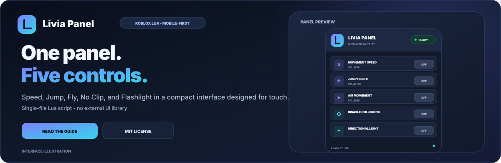
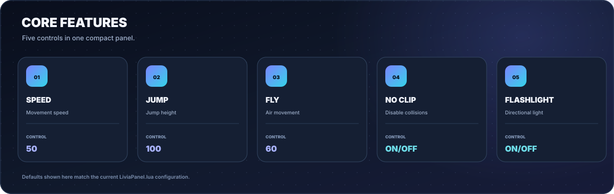
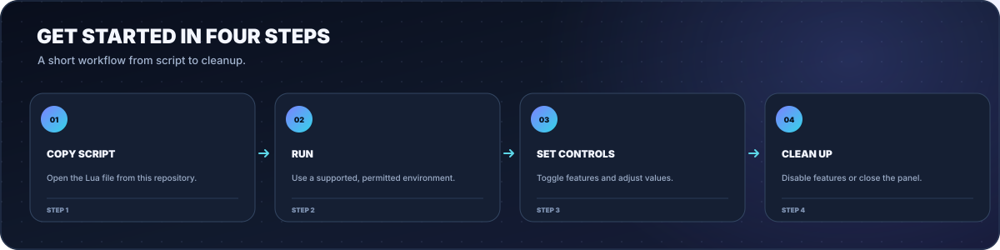
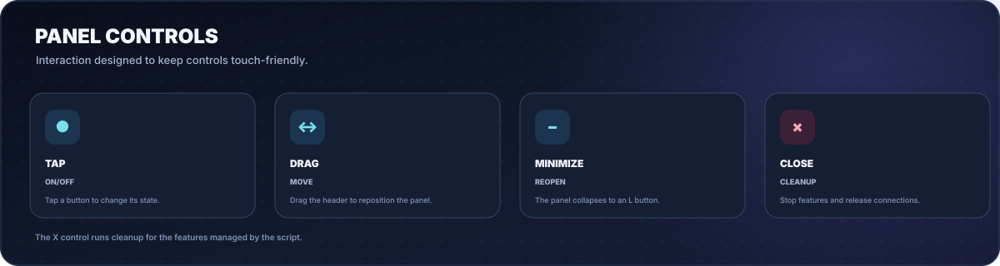
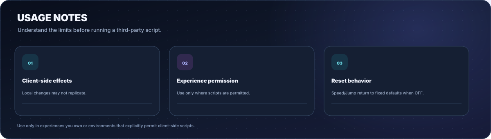

# Livia Panel

  
  
  
  
  

<a href="README.md">Bahasa Indonesia</a> · <a href="README.en.md">English</a>

<strong>One panel. Five controls. Designed for touch.</strong> 
Speed, Jump, Fly, No Clip, and Flashlight in one compact Lua script with a draggable, minimizable interface.

  <a href="#quick-start">Quick start</a> ·
  <a href="#features">Features</a> ·
  <a href="#usage-guide">Usage guide</a> ·
  <a href="#limitations-and-safety">Safety</a> ·
  <a href="#development">Development</a>

---

## About

**Livia Panel** is a single-file Lua script for Roblox environments that support and explicitly permit client-side script execution. It groups movement and lighting controls in a dark interface with indigo-cyan accents, large touch targets, and simple panel controls.

No external UI library is required. The main file is [`LiviaPanel.lua`](LiviaPanel.lua).

> **Note:** README graphics are interface illustrations for documentation, not direct screenshots captured from Roblox. Script behavior still depends on the game and execution environment.

## Quick start

1. Open [`LiviaPanel.lua`](LiviaPanel.lua).
2. Copy the script and run it only in an experience you own or an environment that explicitly permits client-side Lua scripts.
3. Tap **OFF** to enable a feature. For Speed, Jump, and Fly, adjust the numeric value.
4. Drag the panel from its header. Use the minus button to minimize it or **X** to close and clean up the features.

Optional: load from the raw URL in environments that support `loadstring` and `HttpGet`:

~~~lua
loadstring(game:HttpGet("https://raw.githubusercontent.com/akndrn000/LiviaPanel.lua/main/LiviaPanel.lua"))()
~~~

## Features

| Feature | Default | Purpose |
| --- | ---: | --- |
| **Speed** | 50 | Sets `Humanoid.WalkSpeed` while enabled. |
| **Jump** | 100 | Sets `Humanoid.JumpPower` while enabled. |
| **Fly** | 60 | Air movement guided by joystick input and camera orientation. |
| **No Clip** | OFF | Changes `CanCollide` on local character parts and records original values for cleanup. |
| **Flashlight** | OFF | Adds a local `SpotLight` to the head or `HumanoidRootPart`, when available. |
| **Panel** | — | Draggable UI with minimize-to-**L** and close controls. |

## Usage guide

### Panel controls

| Action | Result |
| --- | --- |
| Tap a toggle | Changes the ON/OFF state. |
| Drag more than 10 px | Moves the panel without accidentally activating a button. |
| Minus button | Hides the main panel and shows the **L** button to reopen it. |
| X button | Runs cleanup, stops managed features, disconnects event connections, and removes the UI. |

### Using Fly

The joystick sets movement direction. While moving forward, camera pitch also influences upward/downward movement. Release the joystick to stop moving.

## Defaults and reset behavior

| Feature | When OFF |
| --- | --- |
| Speed | `WalkSpeed` is reset to 16. |
| Jump | `JumpPower` is reset to 50. |
| Fly | Script-created flight forces are removed. |
| No Clip | Recorded `CanCollide` values are restored for character parts that still exist. |
| Flashlight | The script-created `SpotLight` is removed. |

> Speed and Jump use fixed reset values of 16 and 50. Experiences with custom movement systems may have different defaults. Server-authoritative physics can also correct movement changes.

## Limitations and safety

- **Client-side behavior:** local changes are not always replicated to the server. Games may ignore or correct movement changes.
- **No Clip:** only changes the `CanCollide` property of character parts processed by the script. It does not guarantee bypassing server-controlled collision systems.
- **Flashlight:** the light is created locally; appearance and range depend on the experience's lighting.
- **Compatibility:** Roblox or individual experiences may change, which can cause the script to stop working as expected.
- **Use responsibly:** run only in experiences you own or environments that explicitly permit third-party scripts. Follow the experience creator's rules and Roblox's terms.
- The script does not require passwords, cookies, or account credentials.

## Development

The main script is intentionally kept as a single file. README artwork is SVG and can be regenerated without external Python packages.

~~~bash
python3 docs/generate-images.py
~~~

This creates Indonesian and English illustrations in `docs/screenshots/` and the logo at `docs/brand.svg`.

### Repository structure

~~~text
LiviaPanel.lua
README.md
README.en.md
LICENSE
docs/
├── generate-images.py
├── brand.svg
└── screenshots/
    ├── banner.id.svg / banner.en.svg
    ├── preview.id.svg / preview.en.svg
    ├── features.id.svg / features.en.svg
    ├── workflow.id.svg / workflow.en.svg
    ├── controls.id.svg / controls.en.svg
    ├── fly.id.svg / fly.en.svg
    ├── safety.id.svg / safety.en.svg
    └── social-preview.svg
~~~

## Contributing

Bug reports and improvements are welcome through Issues or Pull Requests. Include clear reproduction steps and, when relevant, update both Indonesian and English documentation plus related illustrations. Do not include personal information or account credentials.

## License

Released under the [MIT License](LICENSE).

---

  Livia Panel · Single-file Lua, compact controls, and a touch-first interface.

