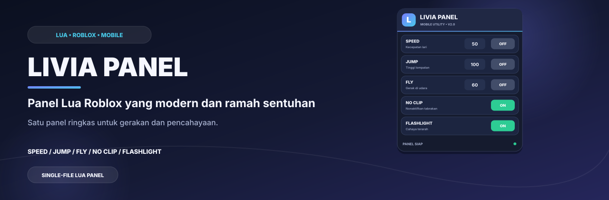
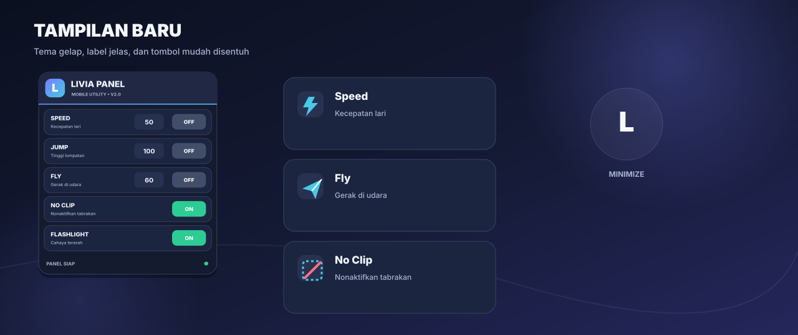
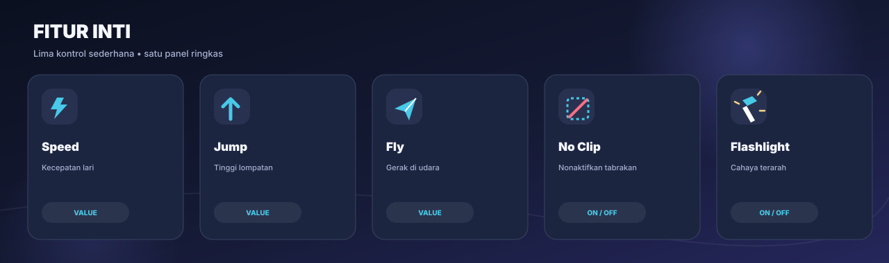
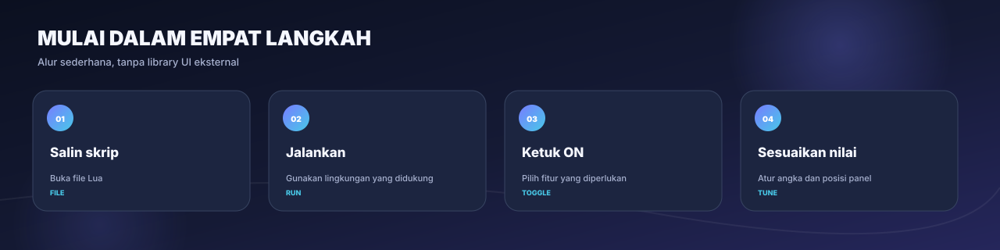
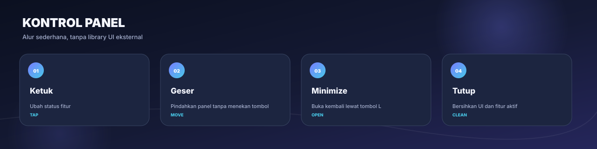
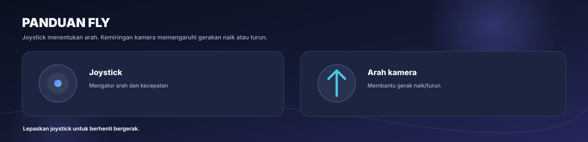
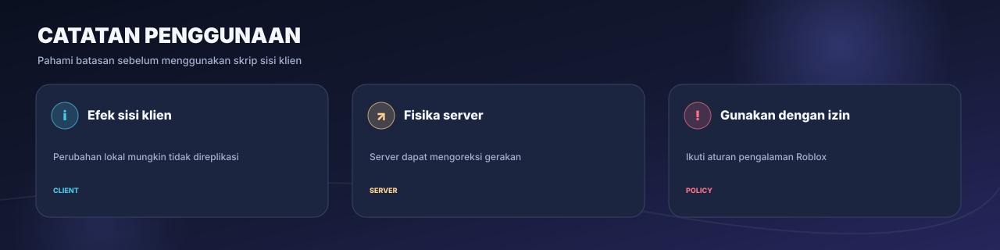

# Livia Panel

[Bahasa Indonesia](README.md) · [English](README.en.md)

**Panel Lua bergaya modern, ringkas, dan nyaman disentuh.** Speed, Jump, Fly, No Clip, dan Flashlight berada dalam satu UI yang dapat digeser dan diminimalkan.

[Fitur](#fitur) · [Pratinjau](#pratinjau) · [Cara-pakai](#cara-pakai) · [Batasan](#batasan-dan-keamanan)

---

## Ringkasan

Livia Panel adalah skrip satu file untuk lingkungan Roblox yang mendukung eksekusi Lua sisi klien. Tampilan diperbarui dengan tema gelap, aksen gradien, label pendukung, dan tombol yang lebih mudah disentuh di layar kecil. Skrip tidak membutuhkan library UI eksternal.

## Pratinjau

## Fitur

| Fitur | Kontrol | Keterangan |
| --- | --- | --- |
| **Speed** | Nilai + ON/OFF | Mengatur WalkSpeed saat aktif. Nilai awal 50. |
| **Jump** | Nilai + ON/OFF | Mengatur JumpPower saat aktif. Nilai awal 100. |
| **Fly** | Nilai + ON/OFF | Gerak udara memakai kamera dan joystick. Nilai awal 60. |
| **No Clip** | ON/OFF | Menonaktifkan CanCollide pada bagian karakter saat aktif, lalu memulihkan nilai yang tercatat saat dimatikan. |
| **Flashlight** | ON/OFF | Menambahkan SpotLight berwarna hangat pada kepala karakter, jika bagian tersebut tersedia. |
| **Panel** | Geser / Minimize / Tutup | Panel dapat digeser; tombol minimize mengubahnya menjadi tombol L untuk membuka kembali. |

## Cara pakai

1. Buka [LiviaPanel.lua](LiviaPanel.lua), lalu salin isi skrip.
2. Jalankan hanya pada lingkungan Roblox yang kamu miliki atau yang memang mengizinkan skrip sisi klien. Dukungan eksekusi berbeda-beda menurut lingkungan.
3. Ketuk tombol OFF untuk mengaktifkan fitur. Untuk Speed, Jump, atau Fly, ubah nilai angka terlebih dahulu atau saat fitur aktif.
4. Geser panel dari area kosong/header. Gunakan tombol minus untuk minimize atau X untuk menutup dan membersihkan fitur yang aktif.

Alternatif pemuatan jarak jauh, hanya pada lingkungan yang mendukungnya:

~~~lua
loadstring(game:HttpGet("https://raw.githubusercontent.com/akndrn000/LiviaPanel.lua/main/LiviaPanel.lua"))()
~~~

## Kontrol panel

| Aksi | Hasil |
| --- | --- |
| Ketuk tombol | Mengubah status ON/OFF. |
| Geser lebih dari 10 px | Memindahkan panel tanpa mengaktifkan tombol. |
| Tombol minus | Menyembunyikan panel utama dan menampilkan tombol L. |
| Tombol X | Mematikan fitur melalui fungsi cleanup, memutus koneksi, dan menghapus UI. |

### Penggunaan Fly

Joystick menentukan arah gerak. Ketika bergerak maju, arah kamera memengaruhi gerak naik/turun. Lepaskan joystick untuk berhenti bergerak.

## Nilai dan mekanisme bawaan

| Fitur | Nilai awal | Saat OFF |
| --- | --- | --- |
| Speed | 50 | WalkSpeed dikembalikan ke 16. |
| Jump | 100 | JumpPower dikembalikan ke 50. |
| Fly | 60 | Gaya terbang dilepas. |
| No Clip | OFF | Nilai CanCollide tersimpan dipulihkan untuk bagian karakter yang masih ada. |
| Flashlight | OFF | SpotLight buatan skrip dihapus. |

> [!NOTE]
> Speed dan Jump memakai nilai pemulihan tetap 16 dan 50. Game yang memiliki sistem gerak khusus mungkin menggunakan nilai berbeda. Beberapa perubahan fisika dapat dikoreksi oleh server.

## Batasan dan keamanan

- No Clip mengubah CanCollide pada karakter lokal. Game yang memakai otoritas fisika server dapat mengabaikan atau mengoreksi pergerakan tersebut.
- Flashlight dibuat sebagai SpotLight lokal pada karakter. Efek dan jarak cahaya dapat terlihat berbeda menurut pencahayaan dan lingkungan.
- Skrip pihak ketiga dapat bertentangan dengan aturan game, diblokir, atau berhenti berfungsi setelah perubahan Roblox. Gunakan hanya di pengalaman milik sendiri atau lingkungan yang mengizinkannya.
- Skrip ini tidak mengakses akun, cookie, kata sandi, atau kredensial.

## Struktur repositori

~~~text
LiviaPanel.lua
README.md
README.en.md
docs/
  generate-images.py
  images/
    banner.id.svg / banner.en.svg
    preview.id.svg / preview.en.svg
    features.id.svg / features.en.svg
    workflow.id.svg / workflow.en.svg
    controls.id.svg / controls.en.svg
    fly.id.svg / fly.en.svg
    safety.id.svg / safety.en.svg
    social-preview.svg
~~~

### Membuat ulang ilustrasi

Jalankan perintah berikut dari folder repositori dengan Python 3:

~~~bash
python3 docs/generate-images.py
~~~

Gambar dibuat sebagai SVG sehingga tetap tajam saat diperbesar. Generator tidak membutuhkan paket Python eksternal.

## Kontribusi

Perubahan dan laporan bug dipersilakan melalui Issues atau Pull Requests. Saat mengusulkan perubahan fitur, sertakan juga pembaruan dokumentasi ID/EN dan ilustrasi yang relevan.

## Lisensi

Dirilis dengan lisensi MIT. Lihat [LICENSE](LICENSE).
