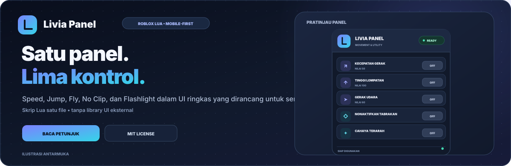
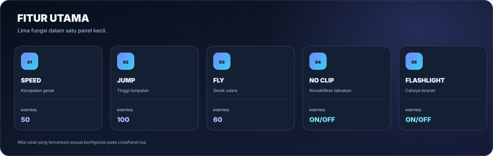
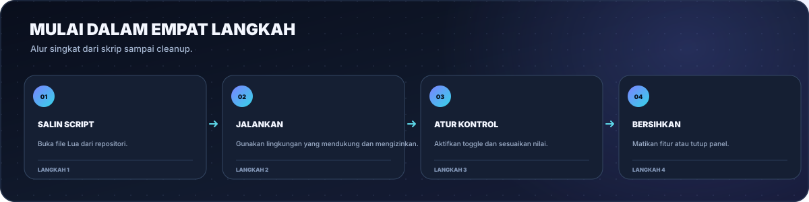
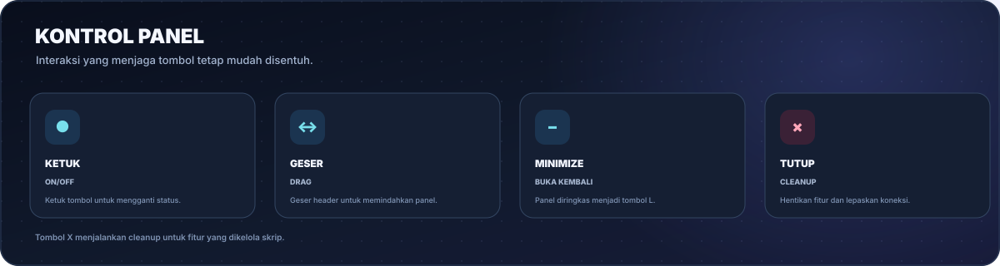
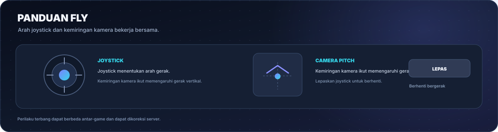
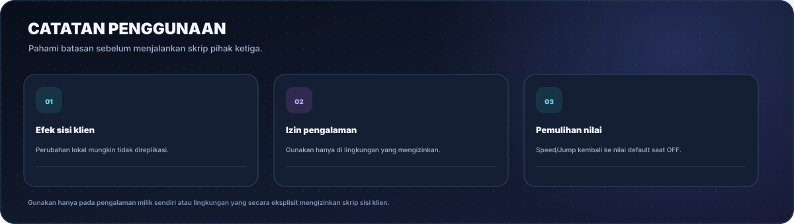

# Livia Panel

  
  
  
  

<a href="README.md">Bahasa Indonesia</a> · <a href="README.en.md">English</a>

<strong>Satu panel. Lima kontrol. Dibuat untuk layar sentuh.</strong> 
Speed, Jump, Fly, No Clip, dan Flashlight dalam satu skrip Lua yang ringkas, dapat digeser, dan dapat diminimalkan.

  <a href="#mulai-cepat">Mulai cepat</a> ·
  <a href="#fitur">Fitur</a> ·
  <a href="#panduan-penggunaan">Panduan</a> ·
  <a href="#batasan-dan-keamanan">Keamanan</a> ·
  <a href="#pengembangan">Pengembangan</a> ·
  <a href="#sumber-atribusi-dan-lisensi">Sumber &amp; lisensi</a> ·
  <a href="#kontribusi">Kontribusi</a> ·
  <a href="#keamanan-proyek">Keamanan</a>

---

## Tentang proyek

**Livia Panel** adalah skrip Lua satu file untuk lingkungan Roblox yang mendukung dan mengizinkan eksekusi skrip sisi klien. Panel menggabungkan kontrol gerakan dan pencahayaan dalam UI bertema gelap dengan aksen indigo-sian, target sentuh besar, dan kontrol panel yang sederhana.

Tidak membutuhkan library UI eksternal. File utama ada di [`LiviaPanel.lua`](LiviaPanel.lua).

> **Catatan:** gambar di README merupakan ilustrasi antarmuka untuk dokumentasi, bukan tangkapan layar langsung dari Roblox. Perilaku skrip tetap bergantung pada game dan lingkungan eksekusi.

## Mulai cepat

1. Buka [`LiviaPanel.lua`](LiviaPanel.lua).
2. Salin skrip dan jalankan hanya pada pengalaman milikmu atau lingkungan yang secara eksplisit mengizinkan skrip Lua sisi klien.
3. Ketuk tombol **OFF** untuk mengaktifkan fitur. Untuk Speed, Jump, dan Fly, sesuaikan nilai angkanya.
4. Geser panel melalui area header. Gunakan tombol minus untuk minimize atau **X** untuk menutup dan membersihkan fitur.

Opsional: pemuatan dari URL mentah hanya untuk lingkungan yang memang mengizinkan `loadstring` dan `HttpGet`. Periksa skrip sebelum menjalankannya; jangan gunakan executor untuk melewati aturan atau keamanan pengalaman Roblox:

~~~lua
loadstring(game:HttpGet("https://raw.githubusercontent.com/akndrn000/LiviaPanel.lua/main/LiviaPanel.lua"))()
~~~

## Fitur

| Fitur | Nilai awal | Fungsi |
| --- | ---: | --- |
| **Speed** | 50 | Mengatur `Humanoid.WalkSpeed` saat aktif. |
| **Jump** | 100 | Mengatur `Humanoid.JumpPower` saat aktif. |
| **Fly** | 60 | Gerak udara dengan arah joystick dan orientasi kamera. |
| **No Clip** | OFF | Mengubah `CanCollide` pada bagian karakter lokal dan mencatat nilai awal untuk pemulihan. |
| **Flashlight** | OFF | Menambahkan `SpotLight` lokal pada kepala atau `HumanoidRootPart` jika tersedia. |
| **Panel** | — | Panel bisa digeser, diminimalkan menjadi tombol **L**, dan ditutup. |

## Panduan penggunaan

### Kontrol panel

| Aksi | Hasil |
| --- | --- |
| Ketuk toggle | Mengubah status ON/OFF. |
| Geser lebih dari 10 px | Memindahkan panel tanpa sengaja mengaktifkan tombol. |
| Tombol minus | Menyembunyikan panel utama dan menampilkan tombol **L** untuk membuka kembali. |
| Tombol X | Menjalankan cleanup, menghentikan fitur yang dikelola, memutus koneksi event, dan menghapus UI. |

### Menggunakan Fly

Joystick menentukan arah gerak. Saat bergerak maju, arah pandang kamera ikut memengaruhi gerak naik/turun. Lepaskan joystick untuk menghentikan gerak.

## Nilai bawaan dan pemulihan

| Fitur | Saat OFF |
| --- | --- |
| Speed | `WalkSpeed` diatur kembali ke 16. |
| Jump | `JumpPower` diatur kembali ke 50. |
| Fly | Gaya gerak terbang yang dibuat skrip dihapus. |
| No Clip | Nilai `CanCollide` yang tercatat dipulihkan untuk bagian karakter yang masih ada. |
| Flashlight | `SpotLight` yang dibuat skrip dihapus. |

> Speed dan Jump memakai nilai pemulihan tetap, yaitu 16 dan 50. Pengalaman dengan sistem gerak khusus mungkin memiliki nilai default berbeda. Perubahan fisika juga dapat dikoreksi oleh server.

## Batasan dan keamanan

- **Perilaku sisi klien:** perubahan lokal tidak selalu direplikasi ke server. Game dapat mengabaikan atau mengoreksi perubahan gerakan.
- **No Clip:** hanya mengubah properti `CanCollide` pada karakter yang diproses skrip. Ini tidak menjamin dapat melewati sistem tabrakan yang dikendalikan server.
- **Flashlight:** cahaya dibuat secara lokal; tampilan dan jangkauan bergantung pada pencahayaan pengalaman.
- **Kompatibilitas:** Roblox atau game dapat berubah sehingga skrip tidak lagi berfungsi seperti sebelumnya.
- **Aturan Roblox:** gunakan untuk mengembangkan atau menguji pengalaman milikmu sendiri atau lingkungan yang secara eksplisit mengizinkan penggunaan ini. Jangan memakai fitur gerak/tabrakan untuk mendapat keuntungan tidak adil di pengalaman orang lain. Roblox menyatakan cheating/exploiting melanggar Ketentuan Penggunaan dan dapat menyebabkan akun dihapus ([panduan resmi](https://en.help.roblox.com/hc/id/articles/203312450-Kecurangan-dan-Eksploitasi)).
- Skrip ini tidak membutuhkan kata sandi, cookie, atau kredensial akun.

## Pengembangan

Skrip utama sengaja dipertahankan sebagai satu file. Ilustrasi README adalah SVG dan dapat dibuat ulang tanpa paket Python eksternal.

~~~bash
python3 docs/generate-images.py
~~~

Perintah di atas menghasilkan ilustrasi Bahasa Indonesia dan Inggris di `docs/screenshots/` serta logo di `docs/brand.svg`.

#### Pemeriksaan dokumentasi

Jalankan `python3 scripts/check_docs.py` untuk memeriksa tautan lokal, validitas XML, isi ilustrasi agar tidak kosong, dan kecocokan gambar Fly yang ditampilkan README dengan generator sumbernya. Pemeriksaan berjalan otomatis lewat GitHub Actions; ini bukan tes runtime di Roblox.

### Struktur repositori

~~~text
LiviaPanel.lua
README.md
README.en.md
LICENSE
CONTRIBUTING.md
SECURITY.md
scripts/
└── check_docs.py
docs/
├── generate-images.py
├── SOURCES.md
├── brand.svg
└── screenshots/
    ├── banner.id.svg / banner.en.svg
    ├── preview.id.svg / preview.en.svg
    ├── features.id.svg / features.en.svg
    ├── workflow.id.svg / workflow.en.svg
    ├── controls.id.svg / controls.en.svg
    ├── fly.id.svg / fly.en.svg / fly-guide.id.svg / fly-guide.en.svg
    ├── safety.id.svg / safety.en.svg
    └── social-preview.svg
~~~

## Sumber, atribusi, dan lisensi

### Sumber rujukan

- [Roblox Creator Hub — Scripting](https://create.roblox.com/docs/id-id/scripting), [Luau](https://create.roblox.com/docs/id-id/luau), dan [referensi API Roblox](https://create.roblox.com/docs/reference/engine) dipakai sebagai referensi konsep bahasa serta API. Ini bukan klaim bahwa proyek merupakan kode resmi Roblox.
- [Dukungan Roblox — Kecurangan dan Eksploitasi](https://en.help.roblox.com/hc/id/articles/203312450-Kecurangan-dan-Eksploitasi) untuk kebijakan penggunaan yang bertanggung jawab.
- Daftar sumber, cakupan atribusi, dan catatan lisensi tersedia di [`docs/SOURCES.md`](docs/SOURCES.md).

### Atribusi aset

Logo dan ilustrasi SVG di `docs/` adalah artwork dokumentasi proyek yang dihasilkan oleh [`docs/generate-images.py`](docs/generate-images.py) menggunakan pustaka standar Python. Gambar tersebut merupakan mockup/diagram, bukan tangkapan layar langsung dari Roblox. Proyek tidak membundel library UI eksternal.

Roblox, Roblox Studio, dan merek pihak ketiga lainnya tetap menjadi milik pemiliknya masing-masing. Livia Panel adalah proyek independen dan tidak berafiliasi dengan, disponsori oleh, atau didukung oleh Roblox Corporation.

### Lisensi MIT

Repositori ini menggunakan [MIT License](LICENSE), dengan pemberitahuan hak cipta 2026 di dalam file `LICENSE`. Lisensi mengizinkan penggunaan, modifikasi, dan redistribusi materi proyek yang tercakup, dengan syarat pemberitahuan hak cipta dan izin dipertahankan. Lisensi ini tidak memberikan hak atas merek dagang atau layanan Roblox. Baca teks `LICENSE` untuk ketentuan lengkapnya.

## Kontribusi

Kontribusi dipersilakan melalui Issues atau Pull Requests. Baca [`CONTRIBUTING.md`](CONTRIBUTING.md) untuk pemeriksaan yang perlu dijalankan dan [`SECURITY.md`](SECURITY.md) untuk pelaporan masalah keamanan. Jangan sertakan informasi pribadi, token, atau kredensial akun.

## Keamanan proyek

Gunakan hanya di pengalaman milikmu sendiri atau lingkungan yang secara eksplisit memberi izin. Jangan memakai Speed, Jump, Fly, atau No Clip untuk mendapatkan keuntungan tidak adil di pengalaman orang lain. Roblox menyatakan cheating/exploiting melanggar Ketentuan Penggunaan dan dapat menyebabkan akun dihapus. Lihat [panduan resmi Roblox](https://en.help.roblox.com/hc/id/articles/203312450-Kecurangan-dan-Eksploitasi).

---

  Livia Panel · Lua satu file, kontrol ringkas, dan UI yang mengutamakan sentuhan.

